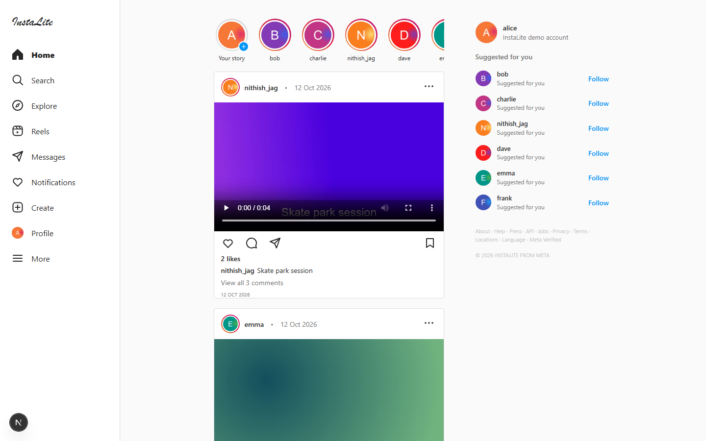
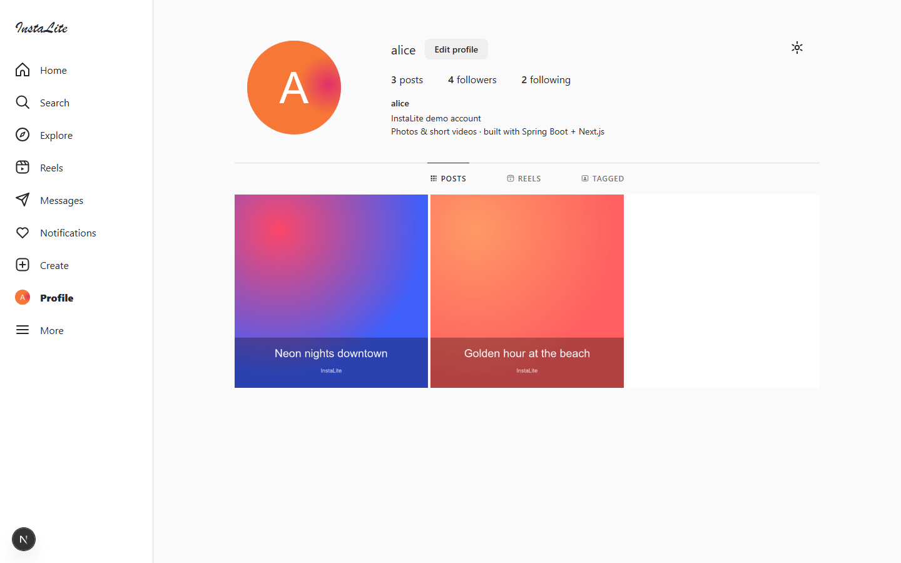
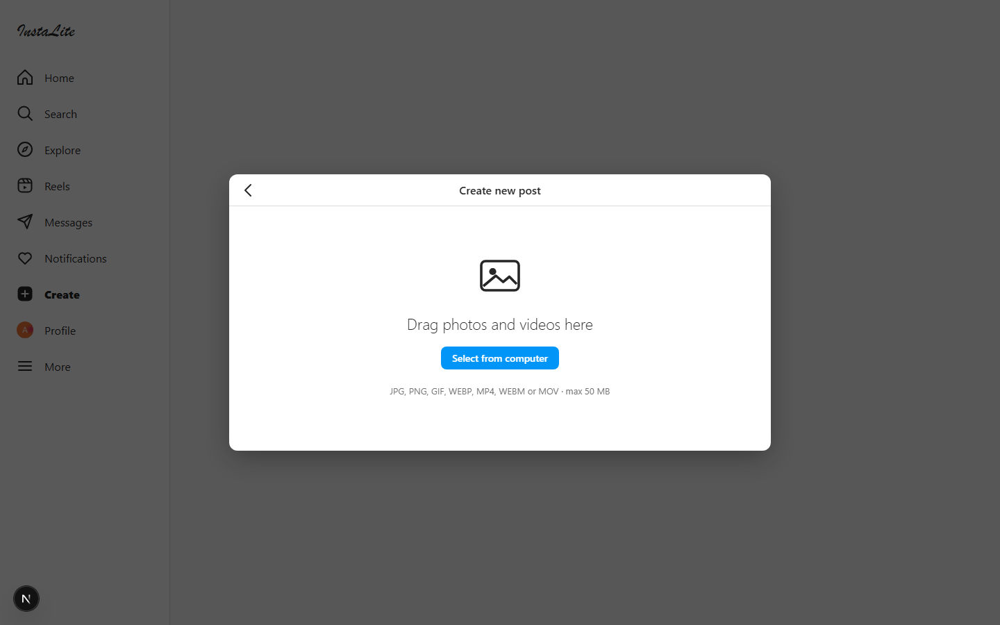
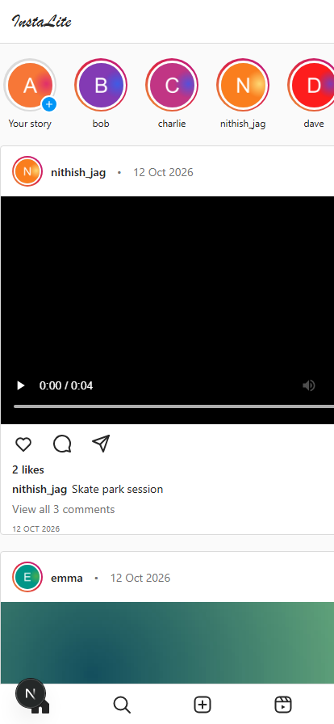
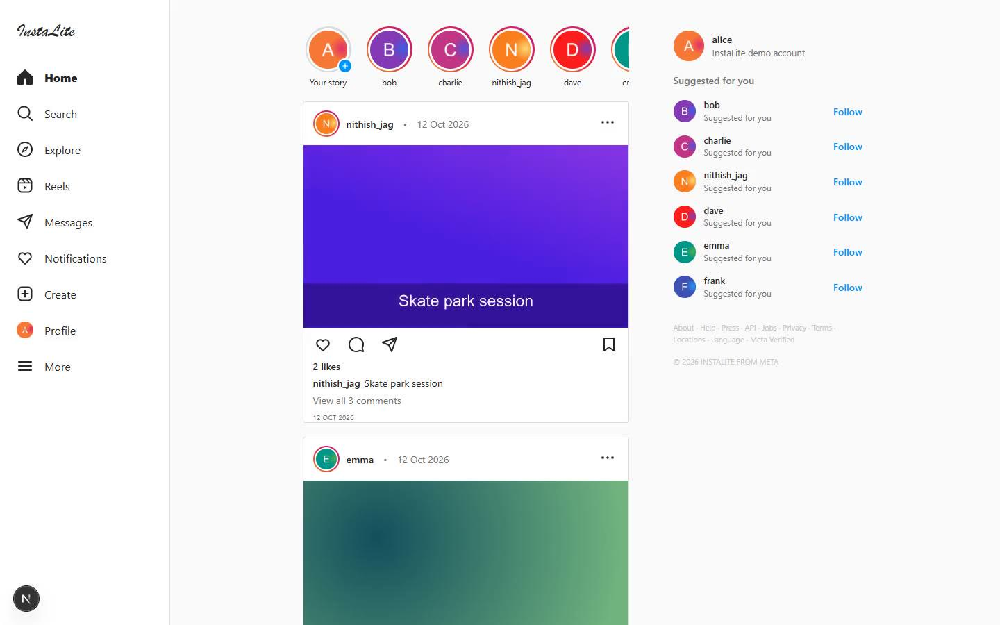

# InstaLite - Instagram-Style Photo & Short Video Platform

A beginner-friendly, runnable implementation of the Round 2 (low-level) and
Round 3 (high-level) system design challenge:

* **Backend:** one Spring Boot application (Java 17+, Maven) - controllers,
  services, repositories, MySQL.
* **Frontend:** one Next.js application (JavaScript, App Router) - `fetch()`
  REST calls, plain CSS.
* **Database:** MySQL 8 - five tables created by Hibernate from the entities.
* **Media:** uploaded images/videos are stored in a local `uploads/` folder;
  MySQL only stores the file path.
* No Docker, no Kubernetes, no Redis, no Kafka, no microservices.

Design answers for Round 2 and Round 3 (architecture, caching, messaging,
scalability) are in [docs/DESIGN.md](docs/DESIGN.md).

---

## Screenshots

Full-screen captures (1440x900) of the running frontend:

| Home feed | User profile |
|---|---|
|  |  |

| Create new post | Mobile layout (414x896) |
|---|---|
|  |  |

## Demo video

A 38-second screen recording of the complete flow: browse the feed -> like a
post -> write a comment -> open the author's profile -> follow -> create and
publish a new post -> see it appear at the top of the feed.

[](docs/screenshots/demo.mp4)

▶ **[Play demo.mp4](docs/screenshots/demo.mp4)** - 1440x900, H.264, ~0.8 MB

> The poster image links straight to the MP4 because GitHub READMEs only play
> videos uploaded as attachments, not in-repo paths. The recording was produced
> by [docs/record-demo.mjs](docs/record-demo.mjs), which drives the real UI over
> the Chrome DevTools Protocol and encodes the captured frames with ffmpeg -
> rerun it with `node docs/record-demo.mjs` to regenerate the video.

---

## 1. Prerequisites

| Tool     | Version        | Check            |
|----------|----------------|------------------|
| JDK      | 17 or newer    | `java -version`  |
| Maven    | 3.8+           | `mvn -v`         |
| Node.js  | 18+            | `node -v`        |
| npm      | comes with Node| `npm -v`         |
| MySQL    | 8.x running on `localhost:3306` | `mysql --version` |
| Postman  | any recent     | for API testing  |

## 2. Database setup

The backend connects with these settings
([instagram-backend/src/main/resources/application.properties](instagram-backend/src/main/resources/application.properties)):

```properties
spring.datasource.url=jdbc:mysql://localhost:3306/instagram_db?createDatabaseIfNotExist=true&...
spring.datasource.username=${MYSQL_USERNAME:root}
spring.datasource.password=${MYSQL_PASSWORD:nith@123}
```

* `createDatabaseIfNotExist=true` creates `instagram_db` automatically, so you
  normally do **not** need to run any SQL.
* The default password above is this machine's local MySQL root password. If
  yours differs, edit `spring.datasource.password` or start the backend with an
  environment variable (keeps the secret out of the file):

```bash
export MYSQL_PASSWORD=your_password     # Windows (cmd): set MYSQL_PASSWORD=your_password
```

Optionally create the schema yourself and use a dedicated user:

```sql
CREATE DATABASE IF NOT EXISTS instagram_db;
CREATE USER IF NOT EXISTS 'insta'@'localhost' IDENTIFIED BY 'insta123';
GRANT ALL PRIVILEGES ON instagram_db.* TO 'insta'@'localhost';
FLUSH PRIVILEGES;
```

Then set `MYSQL_USERNAME=insta` and `MYSQL_PASSWORD=insta123`.

Hibernate creates the five tables (`users`, `posts`, `follows`, `likes`,
`comments`) from the entity classes on first start
(`spring.jpa.hibernate.ddl-auto=update`). On the very first start two demo
users, **alice** and **bob**, are seeded so the follow/like/comment flow can
be tried immediately.

## 3. Run the backend

```bash
cd instagram-backend
mvn spring-boot:run
# or build a jar:
mvn -DskipTests package
java -jar target/instagram-backend-1.0.0.jar
```

Backend base URL: <http://localhost:8080>  
Uploaded media: <http://localhost:8080/uploads/<file>>

## 4. Run the frontend

```bash
cd instagram-frontend
npm install
npm run dev
```

Open <http://localhost:3000>. The backend URL lives in one file only:
[instagram-frontend/lib/api.js](instagram-frontend/lib/api.js)
(`API_BASE_URL`, overridable with `NEXT_PUBLIC_API_URL`).

## 5. Try the application flow

1. Start Spring Boot (port 8080) and Next.js (port 3000).
2. Pick the demo user in the top-right selector (or type a new username and
   press **Add**).
3. Open **Upload**, choose a photo/short video, write a caption, publish.
4. The new post appears on **Home Feed**.
5. Switch to another user in the selector, then like the post, open the
   comments and write one.
6. Open the author's **Profile** and press **Follow** - the follower count
   increases.

---

## 6. REST API reference

All ordinary requests/responses are JSON; media upload uses
`multipart/form-data`.

| Method | Endpoint | Purpose | Success | Failure |
|---|---|---|---|---|
| POST | `/api/users` | Create a user | **201** | 400 (missing/duplicate username) |
| GET | `/api/users` | List users | **200** | 500 |
| GET | `/api/users/{id}` | User profile (+`?followerId=`) | **200** | 404 |
| POST | `/api/users/{id}/follow` | Follow user (`?followerId=`) | **201** | 400 (already following), 404 |
| DELETE | `/api/users/{id}/follow` | Unfollow user (`?followerId=`) | **200** | 400 (not following), 404 |
| POST | `/api/posts` | Upload media + create post | **201** | 400 (bad type/size/no file), 404 (unknown user), 500 (disk error) |
| GET | `/api/posts` | Feed (`?userId=` = profile filter, `?currentUserId=` = viewer) | **200** | 500 |
| GET | `/api/posts/{id}` | Post details (`?currentUserId=` to know if *you* liked it) | **200** | 404 |
| POST | `/api/posts/{id}/likes` | Like a post (`?userId=`) | **201** | 400 (already liked), 404 |
| DELETE | `/api/posts/{id}/likes` | Unlike a post (`?userId=`) | **200** | 400 (not liked), 404 |
| POST | `/api/posts/{id}/comments` | Add a comment | **201** | 400 (empty text), 404 |
| GET | `/api/posts/{id}/comments` | List comments | **200** | 404 |

Status-code convention: **200** OK, **201** Created, **400** invalid request,
**404** resource not found, **500** unexpected server error.

### Postman examples

**Create a user** - `POST http://localhost:8080/api/users`

```json
{ "username": "charlie", "profileImage": "" }
```

**Upload media** - `POST http://localhost:8080/api/posts`
(`Body -> form-data`: `file` = File, `caption` = Text, `userId` = Text)

```
file      : beach.jpg      (type: File)
caption   : Summer vibes   (type: Text)
userId    : 1              (type: Text)
```

Example response (**201 Created**):

```json
{
  "id": 1,
  "user": { "id": 1, "username": "alice", "profileImage": null },
  "caption": "Summer vibes",
  "mediaUrl": "/uploads/8f3c1d4e-....jpg",
  "mediaType": "IMAGE",
  "createdAt": "2026-10-12T14:30:00",
  "likeCount": 0,
  "commentCount": 0,
  "likedByCurrentUser": false
}
```

**Like / unlike**

```
POST   http://localhost:8080/api/posts/1/likes?userId=2      -> 201
DELETE http://localhost:8080/api/posts/1/likes?userId=2      -> 200
```

**Follow / unfollow**

```
POST   http://localhost:8080/api/users/1/follow?followerId=2 -> 201
DELETE http://localhost:8080/api/users/1/follow?followerId=2 -> 200
```

**Comment** - `POST http://localhost:8080/api/posts/1/comments`

```json
{ "userId": 2, "text": "Great shot!" }
```

The same requests are collected in
[docs/postman_collection.json](docs/postman_collection.json) - import it into
Postman (`File -> Import`).

Equivalent `curl` checks:

```bash
curl -X POST http://localhost:8080/api/users \
     -H "Content-Type: application/json" -d '{"username":"charlie"}'

curl -X POST "http://localhost:8080/api/posts" \
     -F "file=@beach.jpg" -F "caption=Summer vibes" -F "userId=1"

curl -X POST "http://localhost:8080/api/posts/1/likes?userId=2"
curl -X POST "http://localhost:8080/api/posts/1/comments" \
     -H "Content-Type: application/json" -d '{"userId":2,"text":"Nice!"}'

curl "http://localhost:8080/api/posts"
curl "http://localhost:8080/api/users/1"
```

---

## 7. Project structure

```text
instagram-backend/
├── pom.xml
├── uploads/                     <- uploaded media lands here
└── src/main/
    ├── java/com/example/instagram/
    │   ├── InstagramApplication.java
    │   ├── controller/  UserController, PostController, CommentController
    │   ├── service/     UserService, PostService, CommentService
    │   ├── repository/  User/Post/Follow/Like/Comment repositories
    │   ├── model/       User, Post, Follow, Like, Comment
    │   └── config/      WebConfig (CORS + /uploads static handler)
    └── resources/application.properties

instagram-frontend/
├── package.json
├── app/
│   ├── layout.js  page.js  globals.css
│   ├── upload/page.js
│   ├── profile/[id]/page.js
│   └── components/  Navbar, PostCard, Feed, CommentSection
├── lib/api.js                  <- backend base URL + fetch helpers
└── public/
```

## 8. How the design questions map to the code

| Design concept (Round 3) | Where it lives here | Where it would grow |
|---|---|---|
| Services for users / media / posts / feeds / notifications | `UserService`, `PostService`, `CommentService` in one app | separate services + message queue |
| Media processing | `PostService.processMedia(...)` - synchronous placeholder | Kafka/RabbitMQ + worker (transcoding, thumbnails) |
| REST communication | Next.js `fetch()` in `lib/api.js`, CORS in `WebConfig` | API gateway |
| Database selection | MySQL for users/posts/follows/likes/comments, disk for files | read replicas, per-domain databases |
| Caching | none yet (fast JPA queries + newest-first feed) | Redis in front of `GET /api/posts` |
| Notifications | not built (out of scope) | fan-out worker triggered by likes/comments/follows |
| Scalability | single instance, local uploads | object storage + CDN + Redis + queue + stateless instances |

Full write-up with diagrams: [docs/DESIGN.md](docs/DESIGN.md).
